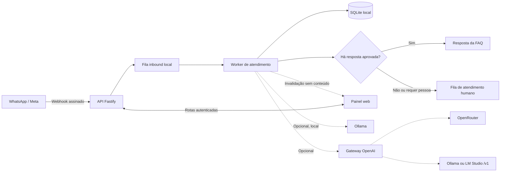

<div align="center">

<h1>💬 Plataforma de Atendimento por WhatsApp</h1>

<p>Atendimento inicial multicliente, respostas de FAQ e transferência para pessoas, com painel local.</p>

<p>
  
  
  
</p>

</div>

> **Estado do projeto:** demonstração local funcional, não pronta para produção. O atendimento completo exige execução em loopback e ambiente não produtivo.

[Começar](#-comece-em-poucos-minutos) · [Arquitetura](#-fluxo-de-atendimento) · [Comandos](#-comandos-úteis) · [Limites](#-limites-e-segurança) · [Documentação](#-documentação)

## ✨ O que já funciona

- Recebimento de webhooks da Meta com verificação HMAC e deduplicação de eventos.
- Roteamento local por canal, com isolamento de conversas por empresa.
- Painel responsivo com login de demonstração, fila, histórico e ações de atendimento humano.
- Atualização da fila em tempo real por SSE autenticado; o evento só avisa que houve uma mudança, e o painel consulta os dados pelas rotas protegidas.
- Persistência local em SQLite para empresas, sessões, conversas, mensagens e filas de entrada e saída.
- Respostas baseadas em FAQ aprovada e encaminhamento para uma pessoa quando não há resposta segura.
- Classificador opcional com Ollama local: escolhe uma resposta já cadastrada, sem redigir conteúdo novo.
- Gateway de IA compatível com OpenAI, usado tanto pela OpenRouter quanto por Ollama ou LM Studio.
- Adaptador de envio Cloud API isolado para teste local, **desligado por padrão** e limitado a uma tentativa externa persistida.

## 🚀 Comece em poucos minutos

### Requisitos

- Node.js **22.13 ou superior**
- npm **10 ou superior**

### Instalação e execução

```bash
git clone https://github.com/jorgepzs/plataforma-atendimento-whatsapp.git
cd plataforma-atendimento-whatsapp
npm run install:all
npm run dev:local
```

Abra o painel em [http://127.0.0.1:5173](http://127.0.0.1:5173). A API fica em `127.0.0.1:3000`. O comando `dev:local` inicia ambos em loopback e salva os dados de demonstração em `.data/attendance.sqlite`.

### Contas de demonstração

| E-mail | Acesso |
| --- | --- |
| `admin@atende.local` | Administração da plataforma e das empresas de demonstração |
| `pizzaria@atende.local` | Atendimento da pizzaria de demonstração |
| `barbearia@atende.local` | Atendimento da barbearia de demonstração |

A senha das contas é `AtendeLocal123!`. **São credenciais públicas de demonstração; nunca as use em um ambiente real.**

Para encerrar API e painel, use `Ctrl+C` no terminal do launcher.

## 🧭 Fluxo de atendimento



O tenant é obtido pelo `phone_number_id` associado ao canal; o webhook não escolhe o tenant por meio de um `tenant_id` enviado pelo cliente. Mensagens sem texto, pedidos que exigem ação operacional e solicitações por atendente seguem para a fila humana. Perguntas que não coincidem com a FAQ vão para o gateway de IA quando ele está ligado e, sem gateway ou sem resposta segura, também seguem para uma pessoa.

## Gateway de IA

O gateway fica desligado até `LLM_PROVIDER` ser definido. OpenRouter e um modelo local usam o mesmo cliente de chat completions; muda só o ambiente. Sem essa variável, FAQ, webhook e fila continuam como antes.

A IA local precisa da máquina do modelo ligada o tempo todo. Ela serve para desenvolvimento e testes. Para atendimento real, use OpenRouter.

### OpenRouter

```dotenv
LLM_PROVIDER=openrouter
LLM_BASE_URL=https://openrouter.ai/api/v1
LLM_API_KEY=sua-chave
LLM_MODEL=openai/gpt-4o-mini
LLM_HTTP_REFERER=https://seu-dominio.example
LLM_APP_TITLE=Plataforma de atendimento
```

Com `LLM_PROVIDER=openrouter`, o cliente envia os cabeçalhos `HTTP-Referer` e `X-Title`.

### Ollama ou LM Studio

Ollama em `http://127.0.0.1:11434/v1` e LM Studio em `http://127.0.0.1:1234/v1` falam o formato OpenAI. Exemplo com Ollama:

```dotenv
LLM_PROVIDER=local
LLM_BASE_URL=http://127.0.0.1:11434/v1
LLM_MODEL=qwen2.5:1.5b
LLM_API_KEY=
```

Para o LM Studio, aponte `LLM_BASE_URL` para `http://127.0.0.1:1234/v1`. Se o servidor exigir autorização, use qualquer valor em `LLM_API_KEY`.

Quando a API roda no Docker e o modelo está no Windows, use o host da máquina, não `127.0.0.1` de dentro do contêiner:

```dotenv
LLM_PROVIDER=local
LLM_BASE_URL=http://host.docker.internal:11434/v1
LLM_MODEL=qwen2.5:1.5b
```

O Compose da API já mapeia `host.docker.internal`. Ollama e LM Studio devem escutar em todas as interfaces, ou pelo menos aceitar conexão vinda do Docker. Não publique a porta do modelo na internet.

`npm run dev:local` lê as variáveis `LLM_*` do `.env` da raiz. `npm run dev:api` carrega o mesmo arquivo. O classificador antigo (`LOCAL_AI_ENABLED`) continua separado e só escolhe uma FAQ pelo endpoint nativo do Ollama.

Se o modelo não aceitar function calling, o gateway repete o pedido sem ferramentas e usa a resposta simples. Timeout ou erro não param a fila: a conversa recebe `LLM_FAILURE_MESSAGE` e, por padrão, segue para uma pessoa (`LLM_FAILURE_ACTION=reply_and_handoff`).

Uma empresa pode sobrescrever provedor, URL, modelo e chave no `PUT /api/v1/tenants/:tenantId/config`, no objeto `llm`. A chave é gravada só para essa empresa e não volta na resposta da API. Ao trocar o provedor, envie de novo URL, modelo e chave.

## 🧱 Tecnologias

| Camada | Tecnologias |
| --- | --- |
| API | Node.js, TypeScript, Fastify e Zod |
| Painel | React, TypeScript e Vite |
| Persistência local | SQLite integrado ao Node (`node:sqlite`) |
| Persistência de eventos PostgreSQL | PostgreSQL e `pg` |
| IA | Gateway compatível com OpenAI (OpenRouter ou Ollama/LM Studio) e classificador opcional de FAQ |
| Infraestrutura preparada | Docker Compose e Caddy |

## 🛠️ Comandos úteis

| Comando | Para que serve |
| --- | --- |
| `npm run dev:local` | Inicia painel e API com SQLite local |
| `npm run dev:memory` | Inicia a demonstração sem persistir estado entre reinícios |
| `npm run check` | Executa typecheck, testes e builds definidos pelo projeto |
| `npm run test:local` | Smoke test local usando armazenamento em memória |
| `npm run test:sqlite` | Smoke test com banco SQLite temporário |
| `npm run test:ollama:smoke` | Valida o fluxo opcional com Ollama local disponível |

Os smoke tests usam portas locais `3000` e `5173`; encerre `dev:local` antes de executá-los.

## 🔒 Limites e segurança

- O modo de atendimento local exige `ENABLE_LOCAL_DEMO=true`, execução fora de produção e API em loopback. O launcher `dev:local` aplica essa configuração automaticamente.
- As respostas do bot e do atendente ficam como `SIMULATED` por padrão. O projeto não envia mensagens ao WhatsApp durante o uso normal.
- O envio de teste é opcional, somente local e não produtivo. Ele exige SQLite, canal e destinatários explicitamente configurados; não é uma integração multi-tenant de produção.
- O store PostgreSQL persiste eventos de webhook, mas ainda não tem o worker conversacional, o painel administrativo e as rotas de atendimento local.
- As contas e credenciais de demonstração não são autenticação de produção. O Compose é uma base de infraestrutura, não uma declaração de prontidão para produção.
- Arquivos `.env`, bancos locais, dados em `.data/` e artefatos em `work/` ficam fora do Git. Configure segredos somente em arquivos privados e nunca os envie em commits.

## 📚 Documentação

- [Especificação técnica](docs/especificacao-tecnica-plataforma-atendimento-whatsapp.md)
- [Ambiente de desenvolvimento no Windows](docs/ambiente-windows.md)
- [Decisão de persistência local com SQLite](docs/adr/0002-persistencia-local-sqlite.md)
- [Classificador de FAQ com Ollama](docs/ia-local-ollama.md)
- [Gateway de IA compatível com OpenAI](docs/adr/0004-gateway-llm-compativel-com-openai.md)
- [Contrato do envio WhatsApp de teste](docs/contrato-saida-whatsapp.md)
- [Gateway local de webhook Cloudflare](docs/cloudflare-webhook-local.md)
- [Demonstração em VPS sem Docker](docs/implantacao-vps-oracle.md)
- [Decisões de arquitetura](docs/adr/)

---

Este projeto está em desenvolvimento. Recursos de produção — incluindo autenticação administrativa, processamento conversacional persistente em PostgreSQL e credenciais de canal por empresa — ainda precisam ser implementados antes de atender clientes reais.

## 📄 Licença

Este repositório ainda não define uma licença. Consulte o responsável antes de reutilizar ou redistribuir o código.
