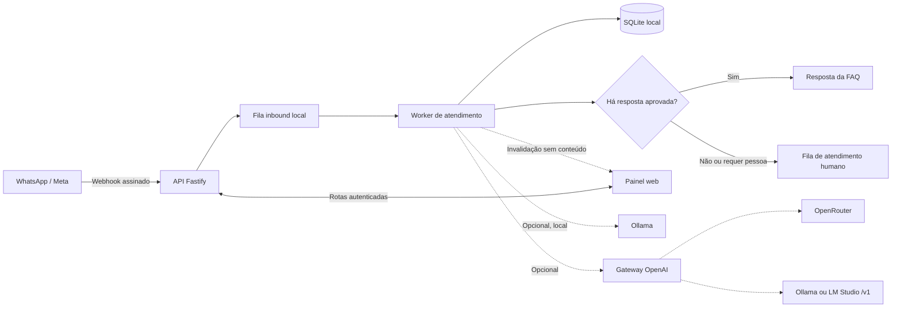

<div align="center">

<h1>💬 Plataforma de Atendimento por WhatsApp</h1>

<p>Atendimento inicial multicliente, respostas de FAQ e transferência para pessoas, com painel local.</p>

<p>
  
  
  
</p>

</div>

> **Estado do projeto:** demonstração local funcional, não pronta para produção. O atendimento completo exige execução em loopback e ambiente não produtivo.

[Começar](#-comece-em-poucos-minutos) · [Arquitetura](#-fluxo-de-atendimento) · [Comandos](#-comandos-úteis) · [Limites](#-limites-e-segurança) · [Documentação](#-documentação)

## ✨ O que já funciona

- Recebimento de webhooks da Meta com verificação HMAC e deduplicação de eventos.
- Roteamento local por canal, com isolamento de conversas por empresa.
- Painel responsivo com login de demonstração, fila, histórico e ações de atendimento humano.
- Atualização da fila em tempo real por SSE autenticado; o evento só avisa que houve uma mudança, e o painel consulta os dados pelas rotas protegidas.
- Persistência local em SQLite para empresas, sessões, conversas, mensagens e filas de entrada e saída.
- Respostas baseadas em FAQ aprovada e encaminhamento para uma pessoa quando não há resposta segura.
- Classificador opcional com Ollama local: escolhe uma resposta já cadastrada, sem redigir conteúdo novo.
- Gateway de IA compatível com OpenAI, usado tanto pela OpenRouter quanto por Ollama ou LM Studio.
- Canal WhatsApp com provedor selecionável por empresa: pareamento por QR (Baileys, desligado por padrão) ou esqueleto da API oficial da Meta.
- Adaptador de envio Cloud API isolado para teste local, **desligado por padrão** e limitado a uma tentativa externa persistida.

## 🚀 Comece em poucos minutos

### Requisitos

- Node.js **22.13 ou superior**
- npm **10 ou superior**

### Instalação e execução

```bash
git clone https://github.com/jorgepzs/plataforma-atendimento-whatsapp.git
cd plataforma-atendimento-whatsapp
npm run install:all
npm run dev:local
```

Abra o painel em [http://127.0.0.1:5173](http://127.0.0.1:5173). A API fica em `127.0.0.1:3000`. O comando `dev:local` inicia ambos em loopback e salva os dados de demonstração em `.data/attendance.sqlite`.

### Contas de demonstração

| E-mail | Acesso |
| --- | --- |
| `admin@atende.local` | Administração da plataforma e das empresas de demonstração |
| `pizzaria@atende.local` | Atendimento da pizzaria de demonstração |
| `barbearia@atende.local` | Atendimento da barbearia de demonstração |

A senha das contas é `AtendeLocal123!`. **São credenciais públicas de demonstração; nunca as use em um ambiente real.**

Para encerrar API e painel, use `Ctrl+C` no terminal do launcher.

## 🧭 Fluxo de atendimento



O tenant é obtido pelo `phone_number_id` associado ao canal; o webhook não escolhe o tenant por meio de um `tenant_id` enviado pelo cliente. Mensagens sem texto, pedidos que exigem ação operacional e solicitações por atendente seguem para a fila humana. Perguntas que não coincidem com a FAQ vão para o gateway de IA quando ele está ligado e, sem gateway ou sem resposta segura, também seguem para uma pessoa.

## Gateway de IA

O gateway fica desligado até `LLM_PROVIDER` ser definido. OpenRouter e um modelo local usam o mesmo cliente de chat completions; muda só o ambiente. Sem essa variável, FAQ, webhook e fila continuam como antes.

A IA local precisa da máquina do modelo ligada o tempo todo. Ela serve para desenvolvimento e testes. Para atendimento real, use OpenRouter.

### OpenRouter

```dotenv
LLM_PROVIDER=openrouter
LLM_BASE_URL=https://openrouter.ai/api/v1
LLM_API_KEY=sua-chave
LLM_MODEL=openai/gpt-4o-mini
LLM_HTTP_REFERER=https://seu-dominio.example
LLM_APP_TITLE=Plataforma de atendimento
```

Com `LLM_PROVIDER=openrouter`, o cliente envia os cabeçalhos `HTTP-Referer` e `X-Title`.

### Ollama ou LM Studio

Ollama em `http://127.0.0.1:11434/v1` e LM Studio em `http://127.0.0.1:1234/v1` falam o formato OpenAI. Exemplo com Ollama:

```dotenv
LLM_PROVIDER=local
LLM_BASE_URL=http://127.0.0.1:11434/v1
LLM_MODEL=qwen2.5:1.5b
LLM_API_KEY=
```

Para o LM Studio, aponte `LLM_BASE_URL` para `http://127.0.0.1:1234/v1`. Se o servidor exigir autorização, use qualquer valor em `LLM_API_KEY`.

Quando a API roda no Docker e o modelo está no Windows, use o host da máquina, não `127.0.0.1` de dentro do contêiner:

```dotenv
LLM_PROVIDER=local
LLM_BASE_URL=http://host.docker.internal:11434/v1
LLM_MODEL=qwen2.5:1.5b
```

O Compose da API já mapeia `host.docker.internal`. Ollama e LM Studio devem escutar em todas as interfaces, ou pelo menos aceitar conexão vinda do Docker. Não publique a porta do modelo na internet.

`npm run dev:local` lê as variáveis `LLM_*` do `.env` da raiz. `npm run dev:api` carrega o mesmo arquivo. O classificador antigo (`LOCAL_AI_ENABLED`) continua separado e só escolhe uma FAQ pelo endpoint nativo do Ollama.

Se o modelo não aceitar function calling, o gateway repete o pedido sem ferramentas e usa a resposta simples. Timeout ou erro não param a fila: a conversa recebe `LLM_FAILURE_MESSAGE` e, por padrão, segue para uma pessoa (`LLM_FAILURE_ACTION=reply_and_handoff`).

Uma empresa pode sobrescrever provedor, URL, modelo e chave no `PUT /api/v1/tenants/:tenantId/config`, no objeto `llm`. A chave é gravada só para essa empresa e não volta na resposta da API. Ao trocar o provedor, envie de novo URL, modelo e chave.

## Canal WhatsApp

O atendimento fala com um único contrato, `WhatsAppProvider`: conectar, status, enviar texto ou mídia, receber mensagens já normalizadas, presença de digitação, recibo de leitura e desconectar. A conversa, a IA, a fila humana e as empresas não conhecem Baileys nem a Graph API.

`whatsapp.provider` por empresa é `unofficial_qr` ou `meta_cloud`. A troca futura para a API oficial é configuração e credencial, não uma reescrita do fluxo.

O canal nasce desligado. Sem `WHATSAPP_CHANNEL_ENABLED=true`, nada é enviado ao WhatsApp.

### Como parear pelo QR

Use um número dedicado. Não use o WhatsApp pessoal principal do cliente, nem o número do aplicativo WhatsApp Business que ele já usa no celular para atender, sem avisar que aquele aparelho deixa de ser a sessão principal.

1. No `.env`, ligue o canal e aponte os diretórios persistentes:

```dotenv
WHATSAPP_CHANNEL_ENABLED=true
WHATSAPP_PROVIDER=unofficial_qr
WHATSAPP_SESSION_DIR=.data/whatsapp/sessions
LOCAL_SQLITE_PATH=.data/attendance.sqlite
ENABLE_LOCAL_DEMO=true
API_HOST=127.0.0.1
```

2. Suba a API (`npm run dev:local` em desenvolvimento). Cada empresa tem a própria sessão.
3. Entre no painel como administrador da empresa e abra **WhatsApp**, ou chame:

```http
POST /api/v1/tenants/{tenantId}/whatsapp/connect
GET  /api/v1/tenants/{tenantId}/whatsapp/qr
```

4. O QR volta como data URL (`data:image/png;base64,...`). No celular: WhatsApp → Aparelhos conectados → Conectar aparelho.
5. `GET /api/v1/tenants/{tenantId}/whatsapp` mostra `connected` e o final do número. As credenciais ficam em `WHATSAPP_SESSION_DIR`. Reiniciar a API não pede novo QR, salvo logout, banimento ou sessão substituída.
6. A reconexão usa espera exponencial com jitter. Logout, banimento, restrição ou outra sessão no mesmo número interrompem o envio, gravam o status e podem avisar `WHATSAPP_ALERT_WEBHOOK_URL`.

Só uma instância pode abrir a mesma sessão. Um segundo processo encontra o lock e não conecta.

### Padrões anti-ban, e por quê

O protocolo não oficial imita o WhatsApp Web. Rajadas, mensagens iguais e número novo em volume alto são o caminho mais curto para restrição ou banimento. Os padrões abaixo são de propósito baixos. Dá para apertar por empresa; o código recusa valores acima do teto.

| Comportamento | Padrão | Motivo |
| --- | --- | --- |
| Só responde quem escreveu primeiro | ligado | Conversa fria é o padrão mais bloqueado |
| Lembretes / envio proativo | desligado | Se ligar, só para contato com mensagem anterior e opt-in |
| Teto global | 4/min, 30/h, 120/dia | Abaixo de um disparo automático |
| Teto por contato | 2/min, 6/h, 15/dia | Evita martelar a mesma pessoa |
| Espera entre envios | 3s a 8s, aleatória | Ritmo humano, não fila instantânea |
| Primeira mensagem ao contato | +12s | O primeiro envio é o mais sensível |
| Digitando antes de enviar | proporcional ao texto, 1,5s a 7s | Presença de digitação e recibo de leitura |
| Texto longo | corta por volta de 800 caracteres | Mensagem única enorme parece automação |
| Links | no máximo 1 por mensagem | Link repetido é sinal de spam |
| Texto idêntico | não reenvia a mesma frase ao mesmo contato por 1h; no máximo 8 destinos iguais em 30 min | Evita campanha disfarçada de FAQ |
| Número novo | 7 dias com tetos menores (1/min, 8/h, 25/dia) | Aquecimento depois do pareamento |
| Opt-out | `SAIR`, `PARAR`, `STOP`, `CANCELAR`, `DESCADASTRAR` | Para o bot na hora e manda uma confirmação |
| Horário silencioso | 21h–8h `America/Sao_Paulo`, só para envio que não é resposta | Resposta a quem chamou continua |
| Banimento ou logout | para a empresa, registra e pode chamar o webhook | Não insiste num número já punido |

Não há rota de disparo em massa. Mensagem proativa, se um dia for ligada, passa pelo mesmo limite e ainda exige opt-in (`POST /api/v1/tenants/{tenantId}/whatsapp/contacts/{phone}/opt-in`). `resume` desfaz um opt-out feito por engano.

Chaves úteis no ambiente: `WHATSAPP_DAILY_CAP`, `WHATSAPP_MESSAGES_PER_MINUTE`, `WHATSAPP_MESSAGES_PER_HOUR`, `WHATSAPP_MIN_DELAY_MS`, `WHATSAPP_MAX_DELAY_MS`, `WHATSAPP_FIRST_MESSAGE_DELAY_MS`, `WHATSAPP_WARMUP_DAYS`, `WHATSAPP_QUIET_START`, `WHATSAPP_QUIET_END`, `WHATSAPP_TIME_ZONE`, `WHATSAPP_MAX_LINKS`, `WHATSAPP_PROACTIVE_ENABLED`. A empresa sobrescreve parte disso em `PUT /api/v1/tenants/{tenantId}/whatsapp`.

### Riscos

Esta rota não é a API oficial. Ela usa o protocolo do WhatsApp Web por uma biblioteca de terceiros e **viola os termos do WhatsApp**. O número pode ser restringido ou banido sem aviso, e uma atualização do WhatsApp pode derrubar a sessão. Jorge aceita esse risco para sair do papel antes de abrir a empresa.

Recomendação prática: um chip novo, só para o atendimento, que possa ser perdido. Não o número pessoal principal. Não o número em que o cliente já atende pelo aplicativo WhatsApp Business, a menos que ele saiba que o celular deixa de ser a sessão dona daquele número.

O painel ainda entra com as contas de demonstração (`AtendeLocal123!`). Antes de publicar o endereço, troque essas senhas. Elas são públicas neste repositório.

### Migrar para a API oficial da Meta

Quando a empresa (ME) existir e a Meta aprovar o app:

1. Crie o app em [developers.facebook.com](https://developers.facebook.com/), adicione o produto WhatsApp e anote o *phone number ID* e um token de longa duração.
2. Aponte o webhook de produção para `https://seu-dominio/api/v1/webhooks/meta`, com `META_VERIFY_TOKEN` e `META_APP_SECRET`. O código de webhook que já existia continua no repositório.
3. Na empresa, `PUT /api/v1/tenants/{tenantId}/whatsapp` com `provider: "meta_cloud"`, `metaPhoneNumberId` e `metaAccessToken`. O token não volta na leitura.
4. Ou, para todas, use `WHATSAPP_PROVIDER=meta_cloud`, `WHATSAPP_META_PHONE_NUMBER_ID` e `WHATSAPP_META_ACCESS_TOKEN`.
5. Encerre a sessão QR (`POST .../whatsapp/logout`) para não haver dois clientes no mesmo número.
6. O envio de texto passa a usar o adaptador da Cloud API que já estava no projeto. Mídia oficial continua um esqueleto (`meta_media_pending`) até o upload da Graph API ser preenchido. Presença de "digitando" não existe na Cloud API do mesmo jeito; a interface aceita a chamada e não finge que enviou.

O teste local antigo (`WHATSAPP_OUTBOUND_ENABLED`) permanece separado, de propósito: uma tentativa, lista fechada de destinatários, só em loopback. Não misture esse modo com o canal de produção.

Para subir o canal no Compose, use os dois arquivos:

```bash
docker compose -f compose.yaml -f compose.whatsapp.yaml up -d --build
```

Esse perfil guarda sessão e SQLite no volume `whatsapp-data` e não usa o Postgres para a conversa. O webhook da Meta continua disponível para a migração.

## 🧱 Tecnologias

| Camada | Tecnologias |
| --- | --- |
| API | Node.js, TypeScript, Fastify e Zod |
| Painel | React, TypeScript e Vite |
| Persistência local | SQLite integrado ao Node (`node:sqlite`) |
| Persistência de eventos PostgreSQL | PostgreSQL e `pg` |
| IA | Gateway compatível com OpenAI (OpenRouter ou Ollama/LM Studio) e classificador opcional de FAQ |
| WhatsApp | Interface `WhatsAppProvider`; Baileys (QR, MIT) ou Cloud API da Meta |
| Infraestrutura preparada | Docker Compose e Caddy |

## 🛠️ Comandos úteis

| Comando | Para que serve |
| --- | --- |
| `npm run dev:local` | Inicia painel e API com SQLite local |
| `npm run dev:memory` | Inicia a demonstração sem persistir estado entre reinícios |
| `npm run check` | Executa typecheck, testes e builds definidos pelo projeto |
| `npm run test:local` | Smoke test local usando armazenamento em memória |
| `npm run test:sqlite` | Smoke test com banco SQLite temporário |
| `npm run test:ollama:smoke` | Valida o fluxo opcional com Ollama local disponível |

Os smoke tests usam portas locais `3000` e `5173`; encerre `dev:local` antes de executá-los.

## 🔒 Limites e segurança

- O modo de atendimento local exige `ENABLE_LOCAL_DEMO=true`, execução fora de produção e API em loopback. O launcher `dev:local` aplica essa configuração automaticamente.
- As respostas do bot e do atendente ficam como `SIMULATED` por padrão. O projeto não envia mensagens ao WhatsApp durante o uso normal.
- O envio de teste é opcional, somente local e não produtivo. Ele exige SQLite, canal e destinatários explicitamente configurados; não é uma integração multi-tenant de produção.
- O store PostgreSQL persiste eventos de webhook, mas ainda não tem o worker conversacional, o painel administrativo e as rotas de atendimento local.
- As contas e credenciais de demonstração não são autenticação de produção. O Compose é uma base de infraestrutura, não uma declaração de prontidão para produção.
- Arquivos `.env`, bancos locais, dados em `.data/` e artefatos em `work/` ficam fora do Git. Configure segredos somente em arquivos privados e nunca os envie em commits.

## 📚 Documentação

- [Especificação técnica](docs/especificacao-tecnica-plataforma-atendimento-whatsapp.md)
- [Ambiente de desenvolvimento no Windows](docs/ambiente-windows.md)
- [Decisão de persistência local com SQLite](docs/adr/0002-persistencia-local-sqlite.md)
- [Classificador de FAQ com Ollama](docs/ia-local-ollama.md)
- [Gateway de IA compatível com OpenAI](docs/adr/0004-gateway-llm-compativel-com-openai.md)
- [Canal WhatsApp e a rota não oficial](docs/adr/0005-canal-whatsapp-nao-oficial.md)
- [Contrato do envio WhatsApp de teste](docs/contrato-saida-whatsapp.md)
- [Gateway local de webhook Cloudflare](docs/cloudflare-webhook-local.md)
- [Demonstração em VPS sem Docker](docs/implantacao-vps-oracle.md)
- [Decisões de arquitetura](docs/adr/)

---

Este projeto está em desenvolvimento. Recursos de produção — incluindo autenticação administrativa, processamento conversacional persistente em PostgreSQL e credenciais de canal por empresa — ainda precisam ser implementados antes de atender clientes reais.

## 📄 Licença

Este repositório ainda não define uma licença. Consulte o responsável antes de reutilizar ou redistribuir o código.
