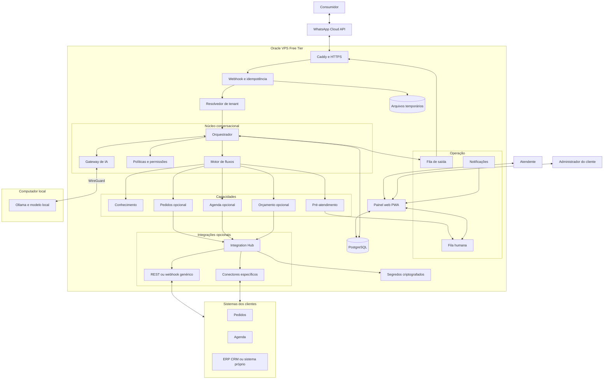
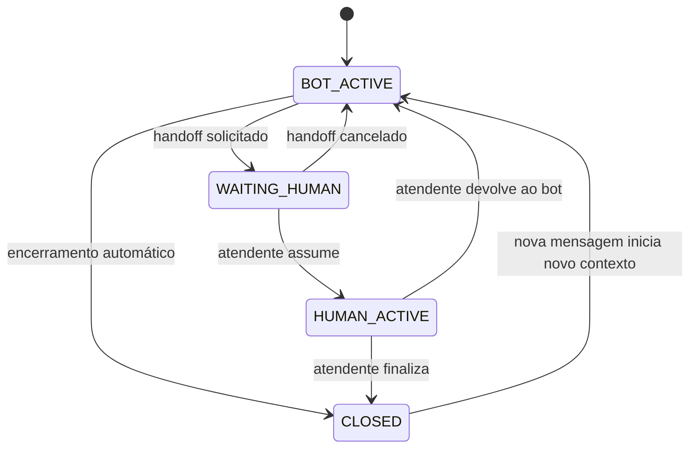
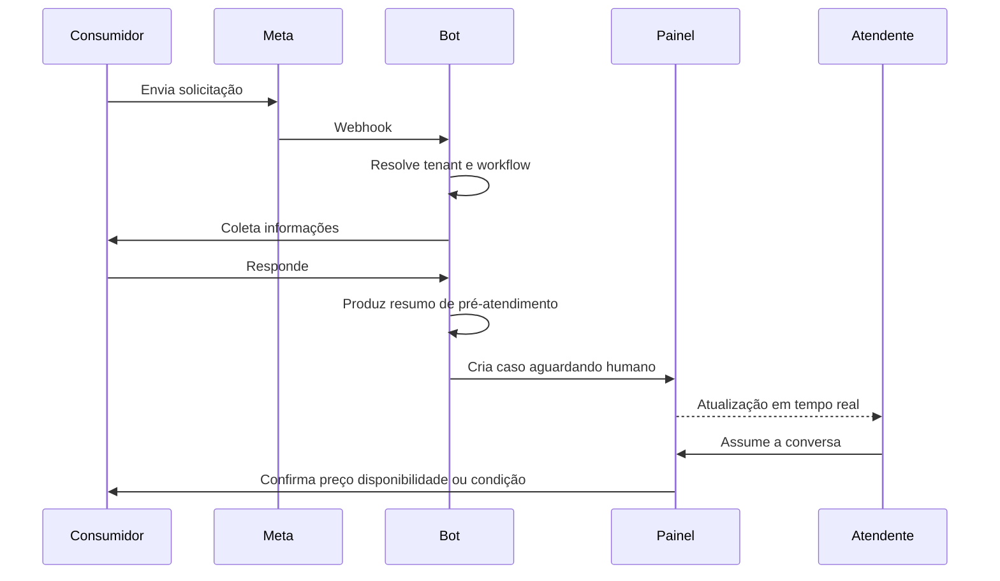
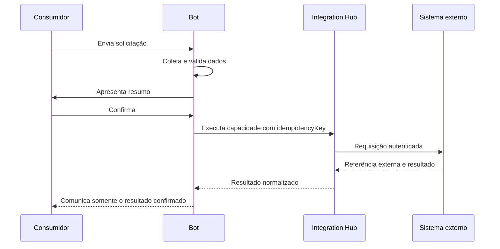
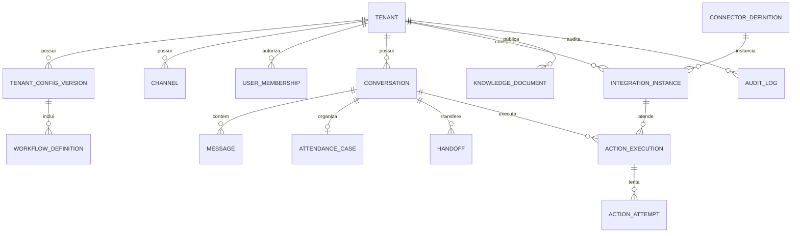

# Especificação técnica da plataforma de atendimento por WhatsApp

| Campo | Valor |
|---|---|
| Status | Proposta para desenvolvimento do MVP |
| Versão | 1.0 |
| Data | 3 de outubro de 2026 |
| Público | Produto, desenvolvimento, infraestrutura e operação |

## 1. Objetivo

Este documento especifica uma plataforma multicliente de atendimento conversacional por WhatsApp. A plataforma utiliza IA para compreender mensagens, responder dúvidas, coletar informações e transferir a conversa para um atendente humano. Integrações com sistemas de pedidos, agenda, CRM ou ERP são opcionais.

A decisão central é manter o núcleo independente do segmento de negócio. Pizzarias, barbearias e outros prestadores utilizam o mesmo motor conversacional, alterando configurações, conhecimento, campos de pré-atendimento, capacidades habilitadas e conectores.

O produto não será um sistema de gestão de pedidos, orçamentos, estoque, caixa ou agenda. Quando não houver sistema externo, ele produzirá um pré-atendimento estruturado e entregará a conversa a uma pessoa. Quando houver integração, o sistema externo continuará sendo a fonte oficial da operação.

## 2. Objetivos do MVP

- Receber e responder mensagens usando a WhatsApp Cloud API oficial.
- Isolar configurações, conversas, usuários e credenciais por cliente.
- Permitir que cada cliente configure identidade, comportamento e conhecimento do assistente.
- Responder perguntas frequentes utilizando apenas informações autorizadas.
- Coletar dados configuráveis de pré-atendimento de maneira conversacional.
- Gerar um resumo e encaminhar a conversa para a fila humana.
- Permitir que atendentes respondam pelo painel web.
- Permitir integrações opcionais por REST, webhook ou conectores específicos.
- Executar o MVP com infraestrutura sem custo mensal dentro dos limites gratuitos disponíveis.
- Impedir tecnicamente o envio acidental de modalidades de mensagem pagas quando o cliente estiver no modo de custo zero.

## 3. Fora do escopo do MVP

- Gestão operacional de pedidos.
- Controle de cozinha, produção ou entrega.
- Controle de estoque.
- Emissão de nota fiscal.
- Conciliação ou processamento financeiro.
- Agenda oficial mantida pela plataforma.
- CRM completo.
- Disparos promocionais ou campanhas em massa.
- Construtor visual genérico de workflows.
- Aplicativos móveis nativos.
- Treinamento de modelos com conversas dos consumidores.

## 4. Conceitos do domínio

| Conceito | Definição |
|---|---|
| Cliente ou tenant | Estabelecimento que contrata e configura a plataforma. |
| Consumidor | Pessoa que conversa com o estabelecimento pelo WhatsApp. |
| Canal | Número e conta da WhatsApp Cloud API associados a um tenant. |
| Conversa | Histórico de mensagens entre consumidor, bot e atendente. |
| Pré-atendimento | Coleta temporária de informações antes da intervenção humana ou integração. |
| Caso de atendimento | Registro organizacional de uma solicitação; não representa pedido, orçamento ou agendamento confirmado. |
| Capacidade | Ação que o bot pode usar, como consultar conhecimento, coletar informações ou consultar uma agenda externa. |
| Workflow | Regras que determinam perguntas, validações e destino do atendimento. |
| Conector | Adaptador entre a plataforma e um sistema externo. |
| Handoff | Transferência do controle da conversa do bot para um atendente. |
| Configuração publicada | Versão imutável da configuração ativa de um tenant. |

## 5. Modos de operação por cliente

### 5.1 Somente atendimento

O bot responde dúvidas simples e transfere a conversa quando necessário. Não cria caso estruturado além do estado mínimo da conversa.

### 5.2 Pré-atendimento

O bot coleta campos configurados, produz um resumo e encaminha a conversa para a equipe. Esse será o modo padrão do MVP para clientes que trabalham exclusivamente pelo WhatsApp.

### 5.3 Atendimento integrado

Após confirmação do consumidor, uma capacidade pode consultar ou executar uma ação em sistema externo. A plataforma guarda o identificador externo e o resultado, mas não assume a gestão da operação.

O modo será definido em `tenant_config_versions.operation_mode` com os valores:

```text
ASSIST_ONLY
INTAKE_AND_HANDOFF
INTEGRATED
```

## 6. Arquitetura lógica



## 7. Topologia de implantação do MVP

### 7.1 Oracle VPS

Serviços em Docker Compose:

- `caddy`: terminação TLS e proxy reverso.
- `api`: endpoints HTTP, autenticação, painel e webhooks.
- `worker`: processamento de mensagens, IA, outbox, integrações e retentativas.
- `web`: aplicação React ou equivalente compilada como PWA.
- `postgres`: persistência principal.

Redis não será obrigatório no MVP. Filas e locks serão implementados em PostgreSQL com tabela de jobs, `FOR UPDATE SKIP LOCKED` e padrão transactional outbox.

### 7.2 Computador local

- Ollama executando modelo pequeno quantizado.
- Conexão privada com a VPS usando WireGuard.
- O endpoint do modelo não deverá ficar exposto à internet.

Se a IA local ficar indisponível, a plataforma continuará executando respostas determinísticas, coleta baseada em formulários ou transferência para humano.

### 7.3 Estrutura recomendada do repositório

```text
apps/
  api/
  worker/
  web/
packages/
  domain/
  contracts/
  capabilities/
  connectors/
  ai/
  security/
  observability/
infra/
  docker/
  caddy/
  migrations/
docs/
```

## 8. Componentes e responsabilidades

### 8.1 Gateway HTTP

- Publicar HTTPS.
- Encaminhar `/webhooks/meta` para a API.
- Encaminhar `/api` para a API.
- Servir o painel web.
- Aplicar limites básicos de requisição.
- Não registrar tokens, conteúdos sensíveis ou parâmetros de autenticação.

### 8.2 Processador de webhooks

- Validar o desafio inicial da Meta.
- Verificar `X-Hub-Signature-256` usando o segredo da aplicação.
- Persistir o evento bruto de maneira controlada.
- Detectar eventos repetidos.
- Responder rapidamente à Meta antes do processamento pesado.
- Enfileirar o processamento transacional.

### 8.3 Resolvedor de tenant

O tenant deverá ser identificado pelo `phone_number_id` recebido e validado da Meta. O `tenant_id` nunca poderá ser aceito do texto enviado pelo consumidor ou de cabeçalhos públicos arbitrários.

Resultado esperado:

```ts
interface TenantContext {
  tenantId: string;
  channelId: string;
  configVersionId: string;
  locale: string;
  timezone: string;
  operationMode: "ASSIST_ONLY" | "INTAKE_AND_HANDOFF" | "INTEGRATED";
}
```

### 8.4 Orquestrador conversacional

- Carregar a configuração publicada do tenant.
- Carregar o estado da conversa.
- Verificar se a conversa está sob controle do bot ou humano.
- Selecionar workflow e capacidades permitidas.
- Solicitar interpretação estruturada à IA quando necessário.
- Validar a saída da IA.
- Executar ações determinísticas.
- Gravar mensagens e eventos.
- Enfileirar respostas para o WhatsApp.

### 8.5 Motor de workflows

O MVP utilizará workflows declarativos versionados, sem editor visual. Cada workflow definirá:

- Gatilhos e intenções.
- Campos a coletar.
- Perguntas sugeridas.
- Validações.
- Condições de conclusão.
- Destino após conclusão.
- Condições de handoff.
- Capacidade externa opcional.

Exemplo simplificado:

```json
{
  "key": "restaurant_pre_service",
  "version": 1,
  "destination": "HUMAN_INBOX",
  "fields": [
    {"key": "items", "type": "text", "required": true},
    {"key": "fulfillment", "type": "enum", "values": ["delivery", "pickup"], "required": true},
    {"key": "address", "type": "address", "requiredWhen": "fulfillment == 'delivery'"},
    {"key": "payment_preference", "type": "text", "required": false}
  ]
}
```

### 8.6 Gateway de IA

- Fornecer uma interface independente do modelo.
- Montar o contexto com identidade, políticas, conhecimento e estado.
- Exigir saída estruturada por schema.
- Aplicar timeout e limite de tokens.
- Impedir que a IA envie mensagens ou faça chamadas HTTP diretamente.
- Registrar modelo, versão de prompt e latência sem registrar dados desnecessários.

### 8.7 Fila humana

- Listar conversas aguardando por ordem de prioridade e tempo.
- Permitir assumir, transferir, devolver ao bot e finalizar.
- Garantir que apenas um atendente possua a conversa por vez.
- Mostrar resumo, motivo do handoff e histórico completo.
- Permitir notas internas que nunca sejam enviadas ao consumidor.

### 8.8 Integration Hub

- Expor capacidades padronizadas ao núcleo.
- Selecionar o conector configurado pelo tenant.
- Traduzir tipos canônicos para o formato externo.
- Aplicar idempotência, timeout, retentativas e circuit breaker.
- Armazenar apenas referência e resultado necessários.
- Receber callbacks autenticados de operações assíncronas.

## 9. Estados da conversa



Regras obrigatórias:

- Em `BOT_ACTIVE`, o bot pode responder.
- Em `WAITING_HUMAN`, o bot pode enviar somente a confirmação de transferência e mensagens explicitamente configuradas.
- Em `HUMAN_ACTIVE`, mensagens automáticas ficam bloqueadas.
- Em `CLOSED`, uma nova mensagem do consumidor pode abrir um novo contexto conforme a política do tenant.
- A troca de estado deve ser transacional e auditada.

## 10. Fluxo sem integração externa



Nesse fluxo não existe pedido ou agendamento interno. Existe um `attendance_case` cuja finalidade é organizar o atendimento.

## 11. Fluxo com integração externa



O bot não poderá afirmar que uma operação está confirmada antes de receber confirmação explícita do sistema externo ou de um atendente.

## 12. Requisitos funcionais

### 12.1 Canal WhatsApp

| ID | Requisito |
|---|---|
| RF-WA-001 | Receber mensagens de texto pela WhatsApp Cloud API. |
| RF-WA-002 | Responder mensagens dentro da janela permitida e das políticas configuradas. |
| RF-WA-003 | Tratar mensagens duplicadas de forma idempotente. |
| RF-WA-004 | Armazenar identificadores externos de mensagem e seus status. |
| RF-WA-005 | Registrar mídia como referência e baixá-la apenas quando necessária. |
| RF-WA-006 | Impedir mensagens pagas quando `allow_paid_messages` estiver desativado. |
| RF-WA-007 | Suportar um ou mais canais por tenant futuramente, mantendo um no MVP. |

### 12.2 Configuração do cliente

| ID | Requisito |
|---|---|
| RF-CFG-001 | Configurar nome, segmento, idioma, fuso e horários. |
| RF-CFG-002 | Configurar nome, tom, tamanho de resposta e uso de emojis. |
| RF-CFG-003 | Configurar perguntas frequentes e políticas. |
| RF-CFG-004 | Habilitar capacidades por tenant. |
| RF-CFG-005 | Configurar workflows e campos de pré-atendimento. |
| RF-CFG-006 | Manter rascunho, teste, publicação e rollback. |
| RF-CFG-007 | Simular uma conversa antes de publicar. |
| RF-CFG-008 | Auditar usuário, data e conteúdo de cada alteração. |

### 12.3 Atendimento humano

| ID | Requisito |
|---|---|
| RF-HUM-001 | Exibir fila em tempo real. |
| RF-HUM-002 | Mostrar resumo e motivo da transferência. |
| RF-HUM-003 | Permitir que um atendente assuma a conversa. |
| RF-HUM-004 | Bloquear o bot durante atendimento humano. |
| RF-HUM-005 | Permitir devolver a conversa ao bot. |
| RF-HUM-006 | Permitir finalizar a conversa. |
| RF-HUM-007 | Exibir aviso sonoro opcional. |
| RF-HUM-008 | Oferecer Web Push como recurso posterior ao MVP básico. |
| RF-HUM-009 | Não expor dados sensíveis em notificações de tela bloqueada. |

### 12.4 Integrações

| ID | Requisito |
|---|---|
| RF-INT-001 | Cadastrar instâncias de integração por tenant. |
| RF-INT-002 | Suportar API REST síncrona. |
| RF-INT-003 | Suportar webhook assíncrono com callback. |
| RF-INT-004 | Permitir conectores específicos. |
| RF-INT-005 | Mapear campos canônicos para campos externos. |
| RF-INT-006 | Testar conexão sem publicar configuração. |
| RF-INT-007 | Exibir histórico com dados sensíveis mascarados. |
| RF-INT-008 | Reprocessar manualmente apenas ações seguras. |
| RF-INT-009 | Utilizar chave de idempotência em ações de escrita. |

## 13. Notificação ao atendente

A notificação significa que uma conversa necessita intervenção humana. Não representa pedido, orçamento ou agendamento criado.

O MVP deverá utilizar Server-Sent Events para atualizar o painel em tempo real. O navegador receberá um evento como:

```json
{
  "type": "handoff.requested.v1",
  "conversationId": "conv_123",
  "attendanceCaseId": "case_456",
  "reason": "PRE_SERVICE_COMPLETED",
  "summary": "Cliente informou itens, entrega e preferência de pagamento.",
  "waitingSince": "2026-10-03T14:30:00-03:00"
}
```

O painel deverá:

- Adicionar a conversa à fila sem recarregar a página.
- Atualizar o contador de conversas aguardando.
- Tocar som apenas se o usuário tiver habilitado esse comportamento.
- Evitar notificações duplicadas para o mesmo handoff.
- Mostrar somente informações mínimas na notificação.
- Abrir a conversa ao selecionar o aviso.

Web Push com VAPID pode ser adicionado após o fluxo dentro do painel estar estável.

## 14. Arquitetura de capacidades e conectores

### 14.1 Contrato interno

```ts
type CapabilityKey =
  | "knowledge.search"
  | "intake.collect"
  | "human.handoff"
  | "catalog.search"
  | "order.quote"
  | "order.create"
  | "order.get_status"
  | "service.list"
  | "appointment.availability"
  | "appointment.create"
  | "appointment.reschedule"
  | "appointment.cancel"
  | "quote.request";

interface CapabilityExecutionRequest<TInput> {
  tenantId: string;
  integrationInstanceId?: string;
  conversationId: string;
  capability: CapabilityKey;
  idempotencyKey: string;
  input: TInput;
  requestedAt: string;
}

interface CapabilityExecutionResult<TOutput> {
  success: boolean;
  status: "COMPLETED" | "ACCEPTED" | "REJECTED" | "FAILED" | "UNKNOWN";
  externalReference?: string;
  output?: TOutput;
  errorCode?: string;
  safeMessage?: string;
  retryable: boolean;
}
```

### 14.2 Manifesto de conector

Cada conector deverá declarar:

- Identificador e versão.
- Capacidades suportadas.
- Schema de autenticação.
- Schema de configuração.
- Schemas de entrada e saída.
- Timeouts.
- Se cada ação é somente leitura ou escrita.
- Se uma ação permite retentativa automática.
- Método de validação de callbacks.

### 14.3 Chave de idempotência

Formato recomendado:

```text
{tenantId}:{conversationId}:{actionExecutionId}
```

A mesma chave deve sempre representar a mesma intenção de escrita. Uma nova tentativa técnica reutiliza a chave; uma nova confirmação do consumidor gera nova execução.

### 14.4 Regras de retentativa

- Consultas de leitura podem ser repetidas com espera exponencial limitada.
- Escritas só podem ser repetidas se o sistema externo oferecer idempotência comprovada.
- Timeout após envio de uma escrita deve produzir estado `UNKNOWN`, não `FAILED` definitivo.
- Estado `UNKNOWN` exige consulta de reconciliação ou atendimento humano.
- Nunca criar uma segunda operação para compensar incerteza sem verificar a primeira.

## 15. Uso da inteligência artificial

### 15.1 Responsabilidades permitidas

- Classificar intenção.
- Extrair campos da mensagem.
- Produzir resposta natural a partir de fatos autorizados.
- Resumir a conversa.
- Identificar necessidade de esclarecimento ou handoff.

### 15.2 Responsabilidades proibidas

- Inventar preço, produto, serviço, horário ou disponibilidade.
- Calcular valores oficiais quando não houver regra determinística.
- Confirmar pedido, orçamento ou agendamento sem fonte autorizada.
- Executar HTTP diretamente.
- Escolher capacidades desabilitadas.
- Alterar configurações.
- Ler dados de outro tenant.

### 15.3 Saída estruturada

```json
{
  "intent": "pre_service",
  "confidence": 0.91,
  "extractedFields": {
    "items": "duas pizzas de calabresa, uma sem cebola",
    "fulfillment": "delivery"
  },
  "missingFields": ["address"],
  "requestedCapability": "intake.collect",
  "handoff": false,
  "responseDraft": "Certo. Qual é o endereço para entrega?"
}
```

O backend validará o JSON contra schema, verificará a capacidade e somente então enviará a resposta.

### 15.4 Montagem do contexto

O contexto será composto por:

1. Política global da plataforma.
2. Configuração publicada do tenant.
3. Capacidades habilitadas.
4. Workflow ativo.
5. Conhecimento recuperado.
6. Estado estruturado do pré-atendimento.
7. Trecho limitado das mensagens recentes.

Conteúdo enviado pelo consumidor será tratado como dado não confiável e nunca como instrução de sistema.

### 15.5 Fallback

Acionar pergunta de esclarecimento ou handoff quando:

- Confiança estiver abaixo do limite configurado.
- A saída não validar contra o schema.
- A IA exceder o timeout.
- O modelo estiver indisponível.
- Ocorrerem duas falhas consecutivas de entendimento.
- A solicitação exigir confirmação humana.

## 16. Modelo de dados



### 16.1 Tabelas principais

| Tabela | Finalidade |
|---|---|
| `tenants` | Cadastro do estabelecimento. |
| `tenant_config_versions` | Configurações em rascunho e publicadas. |
| `channels` | Contas e números WhatsApp. |
| `users` | Usuários do painel. |
| `user_memberships` | Vínculo, papel e permissões por tenant. |
| `conversations` | Estado e propriedade da conversa. |
| `messages` | Mensagens normalizadas de entrada e saída. |
| `attendance_cases` | Resumo e campos de pré-atendimento. |
| `handoffs` | Motivo, fila, atendente e tempos da transferência. |
| `workflow_definitions` | Workflows versionados. |
| `knowledge_documents` | Conteúdo autorizado para respostas. |
| `connector_definitions` | Catálogo de tipos de conectores. |
| `integration_instances` | Configuração de cada conector por tenant. |
| `action_executions` | Execução lógica de uma capacidade. |
| `action_attempts` | Tentativas técnicas de uma execução. |
| `webhook_events` | Eventos recebidos e deduplicação. |
| `outbox_messages` | Mensagens e eventos aguardando envio. |
| `audit_logs` | Alterações administrativas e ações sensíveis. |

Não haverá tabela de pedido obrigatória no núcleo.

### 16.2 Campos essenciais da conversa

```text
id
tenant_id
channel_id
consumer_external_id
mode: BOT_ACTIVE | WAITING_HUMAN | HUMAN_ACTIVE | CLOSED
assigned_user_id
config_version_id
last_consumer_message_at
customer_service_window_expires_at
created_at
updated_at
closed_at
```

### 16.3 Campos essenciais do caso de atendimento

```text
id
tenant_id
conversation_id
workflow_key
workflow_version
status: COLLECTING | WAITING_HUMAN | HUMAN_ACTIVE | CLOSED
collected_data_json
summary
handoff_reason
created_at
updated_at
```

## 17. APIs do MVP

### 17.1 Webhooks públicos

```text
GET  /webhooks/meta
POST /webhooks/meta
POST /callbacks/integrations/{integrationInstanceId}
```

### 17.2 Autenticação e sessão

```text
POST /api/auth/login
POST /api/auth/logout
GET  /api/auth/session
```

O painel utilizará cookie de sessão `HttpOnly`, `Secure` e `SameSite` apropriado. Sessões serão revogáveis e armazenadas no servidor.

### 17.3 Conversas e atendimento

```text
GET  /api/conversations
GET  /api/conversations/{id}
POST /api/conversations/{id}/claim
POST /api/conversations/{id}/messages
POST /api/conversations/{id}/return-to-bot
POST /api/conversations/{id}/close
GET  /api/events/stream
```

### 17.4 Configuração

```text
GET  /api/config/draft
PUT  /api/config/draft
POST /api/config/validate
POST /api/config/simulate
POST /api/config/publish
POST /api/config/rollback/{versionId}
```

### 17.5 Integrações

```text
GET  /api/integrations
POST /api/integrations
PUT  /api/integrations/{id}
POST /api/integrations/{id}/test
GET  /api/integrations/{id}/executions
POST /api/action-executions/{id}/retry
```

Todos os endpoints autenticados devem derivar o tenant da sessão e da associação do usuário, nunca de um `tenant_id` livre enviado pelo frontend.

## 18. Painel web

### 18.1 Perfis de acesso

| Papel | Permissões principais |
|---|---|
| `PLATFORM_ADMIN` | Criar tenants, operar conectores e suporte global. |
| `TENANT_ADMIN` | Configurar seu estabelecimento, integrações e usuários. |
| `SUPERVISOR` | Gerenciar fila, transferências e relatórios operacionais. |
| `ATTENDANT` | Atender conversas autorizadas. |

### 18.2 Telas do MVP

- Login.
- Fila de atendimento.
- Conversa ativa.
- Histórico de conversas.
- Identidade do estabelecimento.
- Personalidade do assistente.
- Horários e regras de atendimento.
- Conhecimento e perguntas frequentes.
- Capacidades habilitadas.
- Workflows de pré-atendimento.
- Integrações.
- Usuários e permissões.
- Simulador.
- Auditoria básica.

### 18.3 Publicação de configuração

```text
RASCUNHO → VALIDAÇÃO → TESTE → PUBLICADO
```

- Rascunho pode ser alterado livremente.
- Validação verifica schemas, referências e segredos necessários.
- Teste executa conversa simulada sem enviar WhatsApp ou gravar operação externa real.
- Publicação cria versão imutável.
- Conversas em andamento continuam com a versão que as iniciou, salvo migração explícita.
- Rollback publica novamente uma versão anterior como nova versão ativa.

## 19. Segurança

### 19.1 Controles obrigatórios

- Verificar assinatura de webhook da Meta.
- Criptografar segredos de integrações em repouso.
- Manter chaves fora do repositório.
- Utilizar HTTPS em todos os acessos externos.
- Aplicar RBAC no backend.
- Aplicar filtro de `tenant_id` em todas as consultas.
- Considerar PostgreSQL Row Level Security como defesa adicional.
- Usar senhas com Argon2id.
- Registrar ações administrativas em auditoria.
- Mascarar telefone, endereço, token e credenciais em logs.
- Limitar tamanho e tipo de anexos.
- Aplicar rate limiting por origem, canal e tenant.
- Expirar sessões e revogar acessos removidos.

### 19.2 Proteção contra SSRF

Como o painel aceitará URLs de integração, o backend deverá:

- Aceitar somente HTTPS no ambiente de produção.
- Bloquear loopback, link-local e faixas de rede privadas.
- Resolver DNS e validar todos os IPs antes de cada conexão.
- Revalidar redirecionamentos.
- Limitar portas permitidas.
- Definir timeout e limite de resposta.
- Preferir allowlist de host por instância de integração.

### 19.3 Isolamento da IA

- A IA não recebe credenciais.
- A IA não acessa banco ou rede diretamente.
- Ferramentas são executadas pelo backend após autorização.
- Saídas são validadas por schema.
- Informações recuperadas sempre carregam o `tenant_id` do contexto autenticado.

## 20. Privacidade e LGPD

A plataforma deverá aplicar minimização, finalidade, transparência, segurança e retenção limitada.

Requisitos mínimos:

- Aviso de que o atendimento inicial é realizado por assistente virtual.
- Informação clara sobre a finalidade da coleta.
- Coleta apenas dos dados necessários ao atendimento.
- Canal para solicitações do titular.
- Política de retenção configurável.
- Exclusão ou anonimização após o prazo definido.
- Proibição de reutilizar conversas para treinamento sem base e autorização adequadas.
- Registro de acesso e alteração de dados sensíveis.
- Processo documentado para incidentes.

Como regra inicial, conteúdos completos de conversa poderão ser retidos por até 90 dias, sujeitos à validação de negócio e privacidade de cada cliente. Dados necessários por obrigação legal ou relação contratual deverão ser tratados fora do histórico conversacional ou com política específica.

A Resolução CD/ANPD nº 2 determina que agentes de pequeno porte adotem medidas administrativas e técnicas essenciais de proteção e mantenham canal para titulares quando não indicarem encarregado.

## 21. Mensageria e controle de custo

Segundo a página oficial consultada na data deste documento, mensagens de serviço enviadas durante a janela de atendimento de 24 horas iniciada pelo consumidor não são cobradas. Preços e políticas podem mudar, portanto o comportamento deverá ser controlado por configuração e monitorado.

Configuração padrão:

```json
{
  "allowPaidMessages": false,
  "allowProactiveMessages": false,
  "requireOpenCustomerServiceWindow": true
}
```

Antes de enviar qualquer mensagem, o worker deverá verificar:

1. Se existe mensagem recente do consumidor.
2. Se a janela está aberta.
3. Se a categoria é permitida.
4. Se o tenant habilitou mensagens potencialmente pagas.
5. Se existe consentimento ou opt-in quando aplicável.

Na dúvida, a mensagem não será enviada e uma pendência será exibida no painel.

## 22. Observabilidade e auditoria

### 22.1 Logs

- JSON estruturado.
- `request_id`, `tenant_id`, `conversation_id` e `execution_id` quando aplicáveis.
- Conteúdo de mensagem desativado por padrão nos logs técnicos.
- Credenciais sempre mascaradas.
- Níveis `debug`, `info`, `warn` e `error` configuráveis.

### 22.2 Métricas mínimas

- Webhooks recebidos, duplicados e rejeitados.
- Mensagens enviadas e com erro.
- Latência da primeira resposta.
- Latência e erro do modelo.
- Tamanho da fila humana.
- Tempo até um atendente assumir.
- Handoffs por motivo.
- Erros por conector e capacidade.
- Jobs pendentes e em dead letter.

### 22.3 Health checks

```text
GET /health/live
GET /health/ready
```

`ready` deve verificar banco, migrações e dependências críticas sem executar ações externas.

## 23. Resiliência e tratamento de erros

- Confirmar o webhook rapidamente e processar de forma assíncrona.
- Deduplicar eventos da Meta.
- Utilizar transactional outbox para não perder mensagens.
- Retentar falhas transitórias com espera exponencial e jitter.
- Mover falhas persistentes para dead letter.
- Expor reprocessamento controlado no painel administrativo.
- Não repetir escritas externas sem garantia de idempotência.
- Transferir para humano quando a IA ou integração estiver indisponível.
- Evitar mensagens técnicas para o consumidor.
- Persistir a versão de configuração usada em cada conversa.

## 24. Backup e recuperação

- Backup diário do PostgreSQL.
- Cópia criptografada fora do volume principal.
- Retenção inicial de sete backups diários e quatro semanais, respeitando a capacidade gratuita.
- Teste mensal de restauração.
- Arquivos temporários não serão considerados fonte primária.
- Configurações publicadas e credenciais deverão ser recuperáveis.
- Definir RPO inicial de 24 horas e RTO inicial de 8 horas para o MVP.

O backup poderá usar o armazenamento gratuito disponível na Oracle e uma segunda cópia criptografada no computador local, desde que os limites sejam monitorados.

## 25. Requisitos não funcionais

| ID | Requisito inicial |
|---|---|
| RNF-001 | Isolamento rigoroso entre tenants. |
| RNF-002 | Toda escrita externa deve ser idempotente ou exigir reconciliação manual. |
| RNF-003 | API deve responder ao webhook antes de processar IA. |
| RNF-004 | Painel responsivo para celular e desktop. |
| RNF-005 | Interface principal deve funcionar a partir de 360 px de largura. |
| RNF-006 | Falha da IA não deve impedir atendimento humano. |
| RNF-007 | Falha de integração não deve resultar em confirmação falsa. |
| RNF-008 | Configuração publicada deve ser versionada e reversível. |
| RNF-009 | Logs não devem expor segredos ou dados pessoais completos. |
| RNF-010 | O MVP deve operar sem Redis e sem serviço pago obrigatório. |

Metas iniciais sujeitas a teste no hardware disponível:

- Processar webhooks em menos de 500 ms antes do trabalho assíncrono.
- Atualizar a fila do painel em até 2 segundos.
- Enviar uma confirmação determinística inicial em até 5 segundos.
- Permitir até 15 segundos para respostas que dependam do modelo local.

## 26. Estratégia de testes

### 26.1 Testes unitários

- Máquina de estados da conversa.
- Políticas de permissão.
- Janela de atendimento e bloqueio de custo.
- Validação de schemas.
- Montagem de contexto.
- Regras de idempotência.
- Mapeamentos de conectores.

### 26.2 Testes de integração

- PostgreSQL real em container.
- Recebimento de webhook assinado.
- Transactional outbox.
- Mock da Graph API.
- Mock do Ollama.
- REST/webhook genérico.
- Callback autenticado.

### 26.3 Testes de contrato

Cada conector deverá executar uma suíte comum:

- Autenticação válida e inválida.
- Consulta com sucesso.
- Timeout.
- Rate limit.
- Escrita idempotente.
- Resposta inválida.
- Callback duplicado.
- Estado desconhecido após timeout.

### 26.4 Testes de ponta a ponta

Casos mínimos:

- Pizzaria sem integração: coleta e handoff.
- Barbearia sem integração: preferência de serviço e horário, seguida de handoff.
- Pizzaria integrada: consulta e criação confirmada externamente.
- Barbearia integrada: consulta de disponibilidade e agendamento externo.
- Consumidor pede atendente imediatamente.
- IA fica indisponível.
- Integração fica indisponível.
- Evento da Meta chega duplicado.
- Dois atendentes tentam assumir a mesma conversa.
- Configuração muda enquanto a conversa está aberta.
- Tenant tenta acessar conversa de outro tenant.

## 27. Plano de desenvolvimento

### Fase 0. Fundação

- Criar monorepo.
- Docker Compose local.
- Migrações do PostgreSQL.
- Convenções de logs, erros e schemas.
- Pipeline de testes.

### Fase 1. Multitenancy e autenticação

- Tenants, usuários, memberships e RBAC.
- Sessões seguras.
- Configuração versionada.
- Auditoria administrativa.

### Fase 2. WhatsApp

- Webhook de validação e eventos.
- Verificação de assinatura.
- Normalização de mensagens.
- Deduplicação.
- Outbox e envio de respostas.
- Travas de custo.

### Fase 3. Núcleo conversacional

- Máquina de estados.
- Orquestrador.
- Workflows declarativos.
- Casos de atendimento.
- Respostas determinísticas.

### Fase 4. Painel humano

- Fila em tempo real por SSE.
- Tela de conversa.
- Assumir, devolver e finalizar.
- Aviso sonoro.
- Notas internas.

### Fase 5. IA local

- Gateway de IA.
- Ollama via WireGuard.
- Schemas de intenção e extração.
- Recuperação de conhecimento.
- Fallback e handoff.
- Simulador.

### Fase 6. Configuração do cliente

- Identidade e personalidade.
- Horários e mensagens.
- Conhecimento.
- Workflows e campos.
- Publicação e rollback.

### Fase 7. Integrações opcionais

- Contratos canônicos.
- Integration Hub.
- Conector REST/webhook genérico.
- Painel de integrações.
- Teste de conexão.
- Retentativas e callbacks.

### Fase 8. Segurança e piloto

- Revisão de isolamento.
- Backup e restauração.
- Testes de carga compatíveis com o VPS.
- Testes de conversas reais anonimizadas.
- Operação assistida com um cliente piloto.

## 28. Critérios de aceite do MVP

- Um número de teste da Meta recebe e responde mensagens.
- O tenant é identificado exclusivamente pelo canal validado.
- Um cliente não consegue acessar dados de outro.
- Administrador configura e publica identidade, conhecimento e workflow.
- Simulador funciona sem enviar mensagens reais.
- Consumidor consegue pedir um atendente a qualquer momento.
- Pré-atendimento concluído gera resumo e entra na fila.
- Atendente recebe atualização no painel em tempo real.
- Apenas um atendente assume a conversa.
- Bot para de responder durante atendimento humano.
- Resposta humana enviada pelo painel chega ao WhatsApp.
- Falha da IA transfere ou usa fallback determinístico.
- Webhook duplicado não gera mensagens ou ações duplicadas.
- O modo de custo zero bloqueia mensagens não autorizadas.
- Integração genérica executa teste sem expor credenciais.
- Escritas integradas usam chave de idempotência.
- Sistema nunca informa confirmação sem fonte humana ou externa.
- Backup é restaurado com sucesso em ambiente de teste.
- Cem conversas simuladas cobrem pizzaria e barbearia antes do piloto.

## 29. Decisões arquiteturais iniciais

| Decisão | Justificativa |
|---|---|
| Monólito modular no MVP | Menor consumo e operação mais simples no Free Tier. |
| PostgreSQL como banco e fila | Evita Redis e reduz componentes. |
| SSE para fila humana | Comunicação servidor para navegador simples e suficiente. |
| PWA responsiva | Atendentes podem usar computador ou celular sem aplicativo nativo. |
| IA atrás de gateway | Permite trocar modelo ou local de execução. |
| Capacidades tipadas | Evita um conector genérico inseguro e difícil de validar. |
| Integrações opcionais | Atende clientes que trabalham somente no WhatsApp. |
| Casos de atendimento, não pedidos | Mantém o produto no escopo de facilitação do atendimento. |
| Configuração versionada | Permite teste, auditoria e rollback. |
| Cloud API oficial | Reduz risco de bloqueio e dependência de automação não autorizada. |

## 30. Questões a decidir no início do desenvolvimento

Estas questões não impedem a construção da fundação, mas devem ser fechadas antes do piloto:

- Especificações de CPU, RAM e GPU do computador que executará o modelo.
- Forma exata e recursos disponíveis na VPS Oracle existente.
- Primeiro estabelecimento piloto e seu fluxo real de atendimento.
- Número WhatsApp novo ou existente para o piloto.
- Prazo de retenção aprovado para conversas e anexos.
- Volume esperado de conversas simultâneas.
- Primeiro sistema externo, caso o piloto utilize integração.
- Campos obrigatórios do pré-atendimento da pizzaria.
- Campos obrigatórios do pré-atendimento da barbearia.
- Política de atendimento fora do horário.
- Pessoas que terão papéis de administrador, supervisor e atendente.

## 31. Referências externas

- [WhatsApp Business Developer Hub](https://whatsappbusiness.com/developers/developer-hub/)
- [Preços da WhatsApp Business Platform](https://business.whatsapp.com/products/platform-pricing/)
- [Termos do WhatsApp Business](https://www.whatsapp.com/legal/WhatsApp-Terms-for-WhatsApp-Business-App)
- [Oracle Cloud Always Free](https://docs.oracle.com/pt-br/iaas/Content/FreeTier/freetier_topic-Always_Free_Resources.htm)
- [Gemma com Ollama](https://ai.google.dev/gemma/docs/integrations/ollama)
- [Resolução CD ANPD número 2](https://www.gov.br/anpd/pt-br/acesso-a-informacao/institucional/atos-normativos/regulamentacoes_anpd/resolucao-cd-anpd-no-2-de-27-de-janeiro-de-2022)

